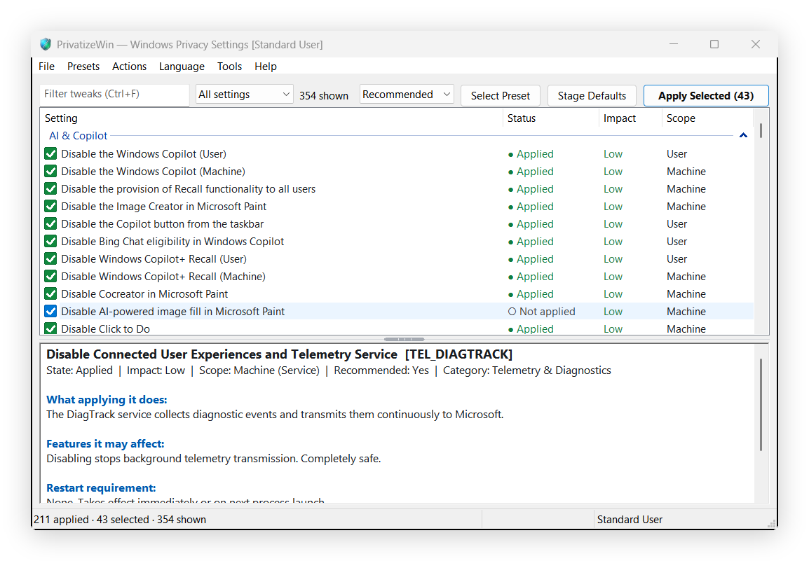

# PrivatizeWin

<div align="center">


### PrivatizeWin
**Modern, Transparent Windows Privacy & Telemetry Silencer**  
*A lightweight, open-source alternative to O&O ShutUp10++ with complete dual GUI and headless CLI.*

[](https://github.com/saverchenkov/PrivatizeWin/actions/workflows/ci.yml)
[](LICENSE)
[](https://en.wikipedia.org/wiki/C%2B%2B20)
[](https://microsoft.com)
[](#-lightweight-native-architecture)
[](CATALOG.md)

</div>

---

## 🎯 Why PrivatizeWin?

Recent headlines suggest that [*the future of Windows could include fewer ads and distracting upsells*](https://www.digitaltrends.com/computing/the-future-of-windows-could-include-fewer-ads-and-distracting-upsells/).

**How about no ads and no upsells at all?**

Windows 10 and Windows 11 are powerful operating systems, but out of the box they increasingly treat your PC as a data-harvesting terminal and an ad-delivery network. Diagnostic telemetry, biometric analysis, keystroke tracking, Recall AI desktop snapshot recordings, Copilot integration, Start menu "promoted apps", lock screen advertisements, Edge shopping trackers, and persistent OneDrive/Microsoft 365 upgrade banners run continuously in the background.

While Microsoft provides privacy toggles in the Settings app, they are deliberately fragmented across dozens of convoluted submenus, Group Policy Editor paths, and cryptic registry keys. Worse, **cumulative Windows Updates routinely reset these choices back to factory defaults without notice**.

**PrivatizeWin puts you back in complete control of your operating system:**
* **You Decide:** Control exactly what data Windows transmits to Microsoft servers and what stays strictly on your machine.
* **No Upsells, No Nagware:** Silence promotional suggestions, lock screen ads, dynamic MSN taskbar feeds, and forced cloud migrations with a single click.
* **Stay Privatized Permanently:** Use built-in automated scheduling to re-enforce your privacy configuration in the background, preventing Windows Update from undoing your settings.
* **100% Free & Transparent:** Standalone, portable C++ executable. No installers, no background telemetry, no web wrappers, no third-party ads, licensed under MIT.

---

## 🖥️ Graphical Interface

<p align="center">
  
</p>

* **Non-Destructive Staging:** Clicking **Select Preset** or **Stage Defaults** simply stages checkboxes with color-coded intent badges and subtle row highlights. Nothing touches your system until you review your selection and click **Apply Selected**.
  * <span style="color:#2ea043">**[✔] Solid Green:**</span> Already active and verified protected on your system.
  * <span style="color:#0969da">**[☑] Solid Blue:**</span> Pending change staged to be applied/protected.
  * <span style="color:#cf222e">**[-] Solid Red:**</span> Pending change staged to be reverted back to Windows defaults.
  * <span style="color:#6e7781">**[ ] Faint Grey:**</span> Not applicable to your current Windows edition or hardware.
* **Semantic Status & Impact Highlighting:** Color-coded **Status** (`Applied`, `Partial`, `Custom`, `Not applied`) and **Impact** (`Low`, `Moderate`, `High`) columns make scanning 354 settings effortless.
* **Sortable Columns & Multi-Row Selection:** Click any column header (**Setting**, **Status**, **Impact**, **Scope**) to sort ascending/descending (third click resets to catalog order). Select multiple rows with `Shift+Click` or `Ctrl+Click` and press `Space` to stage/unstage them in bulk, or right-click to expand/collapse all categories at once.
* **Compact Draggable Inspector:** Click and drag the centered grip handle to smoothly expand or shrink the lower technical details pane.
* **Rich Setting Inspector:** Formatted with hierarchical typography, `[ID]` badge, accent section headers, and `Consolas` monospace registry/service paths so you can instantly inspect what each setting does, its functional impact, restart requirements, and exact registry/service targets.
* **Instant Cached Search:** Zero-latency fuzzy filtering by setting title, ID, description, or localized name (`Ctrl+F`).
* **Presets for Every Need:** One-click staging for **Recommended** (maximum privacy with zero breakage), **Strict Privacy** (hardened privacy for power users), and **Minimal**.
* **Safety First:** Validates staged plans for conflicts prior to execution, prompts for administrator elevation on-demand with secure token-verified state handoff, and supports one-click System Restore Point creation.

---

## 🚀 Command-Line Interface (CLI)

PrivatizeWin includes a headless, scriptable command-line interface. Passing any command-line argument automatically runs in CLI mode—ideal for sysadmins, enterprise deployments, logon scripts, and CI/CD environments.

### Quick Reference

```bash
# View all available CLI options
PrivatizeWin.exe --help

# Audit current privacy status across all 350+ settings
PrivatizeWin.exe --status

# Output audit in JSON format for automated pipelines
PrivatizeWin.exe --status --output json

# Apply the recommended privacy preset
PrivatizeWin.exe --apply-template recommended

# Test a configuration safely without making changes
PrivatizeWin.exe --apply-template strict --dry-run

# Apply a custom enterprise JSON policy silently
PrivatizeWin.exe --apply-template C:\corp\hardened.json --quiet

# Revert all settings back to Windows factory defaults
PrivatizeWin.exe --revert

# Schedule automatic daily re-enforcement (combats Windows Update resets)
PrivatizeWin.exe --install-task daily --task-template recommended
```

---

### Command & Option Reference

| Option | Argument | Description |
| :--- | :--- | :--- |
| `--status` | *None* | Audits all 354 settings in the [Catalog](CATALOG.md) and displays their current state (`Applied`, `Partial`, `Custom`, `Not applied`, or `Not applicable`). |
| `--output` | `text` \| `json` | Sets status output format. `text` displays a formatted console table; `json` outputs structured JSON for scripting. |
| `--apply-template` | `<name\|path>` | Applies a privacy profile. Accepts built-in presets (`recommended`, `strict`, `minimal`) or a file path to a `.json` profile. |
| `--list-templates` | *None* | Lists all built-in presets and auto-detected JSON profiles in the current directory. |
| `--revert` | *None* | Reverts all managed privacy tweaks back to standard Windows factory defaults. |
| `--dry-run` | *None* | Simulates execution without making any actual changes to the Windows Registry or services. |
| `--quiet`, `-q`, `--silent` | *None* | Suppresses console output and message boxes. Preserves error exit codes for headless automation. |
| `--users` | `all` \| `current` \| `none` \| `<list>` | Controls user profile targeting (see below). Defaults to `all`. |
| `--install-task` | `daily` \| `logon` \| `weekly` | Registers a recurring background task in Windows Task Scheduler (default trigger: daily at 12:00 PM). |
| `--task-template` | `<name\|path>` | Specifies which template the background scheduled task enforces (default: `recommended`). |
| `--uninstall-task` | *None* | Removes the PrivatizeWin scheduled background task. |
| `--create-restore-point` | *None* | Creates a Windows System Restore Point before applying changes (opt-in). |
| `--no-restore-point` | *None* | Explicitly disables System Restore Point creation. |
| `--help`, `-h`, `/?` | *None* | Prints CLI usage documentation. |

---

### Multi-User Hive Targeting (`--users`)

Unlike basic batch scripts that only touch the current user account, PrivatizeWin can inspect and configure all user profiles across the operating system using a batch-mounted hive session:

```bash
# Apply to all user profiles (including unloaded profiles and the Default User template)
PrivatizeWin.exe --apply-template recommended --users all

# Apply only to the currently logged-in user session
PrivatizeWin.exe --apply-template recommended --users current

# Skip user settings entirely and apply only machine-wide policies (HKLM & services)
PrivatizeWin.exe --apply-template strict --users none

# Target specific user accounts by username or SID
PrivatizeWin.exe --apply-template recommended --users alice,bob
```

> [!NOTE]
> **Elevation Context (UAC):** When executing from an elevated prompt or UAC Over-The-Shoulder elevation, the "current user" session corresponds to the administrator account that approved elevation. To configure settings for a standard user from an elevated context, specify the user account explicitly via `--users <username>` or use `--users all` to update all user hives.

---

### Automated Background Reapplication

Windows Updates frequently restore disabled telemetry services and telemetry keys. PrivatizeWin solves this with built-in Task Scheduler COM integration:

```bash
# Enforce the recommended preset daily at noon
PrivatizeWin.exe --install-task daily --task-template recommended

# Enforce strict privacy every time any user logs on
PrivatizeWin.exe --install-task logon --task-template strict

# Remove the scheduled task when no longer needed
PrivatizeWin.exe --uninstall-task
```

### Exit Codes

| Exit Code | Constant | Meaning |
| :---: | :--- | :--- |
| `0` | `Success` | All requested operations succeeded (or already matched target state). |
| `1` | `GeneralError` | One or more settings failed to apply, or a task scheduler operation failed. |
| `2` | `InvalidArguments` | Unrecognized CLI flag, missing argument, or invalid option value. |
| `3` | `ElevationRequired` | Administrator privileges are required for the requested operation. |
| `4` | `TemplateNotFound` | Template file could not be loaded, failed validation, or contained conflicting actions. |
| `5` | `UserNotFound` | One or more usernames/SIDs specified via `--users` do not exist on the system. |

---

## 📑 Custom Profile JSON Format

Export and import custom configuration profiles directly in the GUI or CLI using standard JSON:

```json
{
  "name": "enterprise-hardened",
  "description": "Hardened privacy baseline for corporate workstations.",
  "tweaks": {
    "TEL_DIAGTRACK": true,
    "TEL_DIAGDATA": true,
    "AI_COPILOT": true,
    "AI_RECALL": true,
    "SRCH_BING_START": true,
    "PRIV_AD_ID": true,
    "PRIV_TAILORED": true,
    "LOCK_SPOTLIGHT_ADS": true,
    "SHELL_PROMOTED_APPS": true,
    "EDGE_SHOPPING": true,
    "WU_DELIVERY_OPT": true
  }
}
```

* Setting keys to `true` applies the privacy protection.
* Setting keys to `false` restores the setting back to the Windows default.
* Profiles are sparse: settings not listed in the file are left untouched.

---

## ⚡ Lightweight, Native Architecture

PrivatizeWin is built with pure native Win32 controls and modern **C++20** (`/std:c++20`, `/permissive-`, `/W4`):
* **No Dependencies:** Compiled as a single static binary (< 1 MB) without .NET, webviews, Electron, or external runtimes.
* **Instant Startup:** Launches in under 50 milliseconds with minimal memory usage (~10 MB RAM).
* **RAII Resource Safety:** Strict adherence to modern C++ resource management with type-safe smart wrappers for all Win32 handles, registry keys, and service handles.

---

## 🛠️ Building from Source

### Prerequisites
* Windows 10 or 11 (x64 or ARM64)
* Visual Studio 2022 (Community or Build Tools) with C++20 support
* CMake 3.20+ and Ninja

### Build Instructions

PrivatizeWin includes a universal Makefile and `build.bat` helper to easily produce both **`_x65`** (x64) and **`_arm`** (ARM64) standalone binaries:

```cmd
# Option A: One-click batch runner (auto-detects Visual Studio environment)
build.bat all       # Compiles both _x65 and _arm binaries into bin\
build.bat x65       # Compiles PrivatizeWin_x65.exe (and PrivatizeWin_x64.exe)
build.bat arm       # Compiles PrivatizeWin_arm.exe (and PrivatizeWin_arm64.exe)

# Option B: Using NMake or GNU Make
nmake all           # or 'make all'
nmake x65           # or 'make x65'
nmake arm           # or 'make arm'

# Option C: Direct CMake configuration
# x65 / x64:
cmake -B build_x64 -G Ninja -DCMAKE_BUILD_TYPE=Release -DARCH_SUFFIX=_x65
cmake --build build_x64 --config Release

# ARM / ARM64:
cmake -B build_arm -G Ninja -DCMAKE_BUILD_TYPE=Release -DARCH_SUFFIX=_arm -DCMAKE_SYSTEM_NAME=Windows -DCMAKE_SYSTEM_PROCESSOR=ARM64
cmake --build build_arm --config Release
```

Output binaries are placed in `bin/` (and the respective build directories):
* `PrivatizeWin_x65.exe` (with `PrivatizeWin_x64.exe` alias)
* `PrivatizeWin_arm.exe` (with `PrivatizeWin_arm64.exe` alias)


---

## 📄 License

PrivatizeWin is licensed under the [MIT License](LICENSE).
